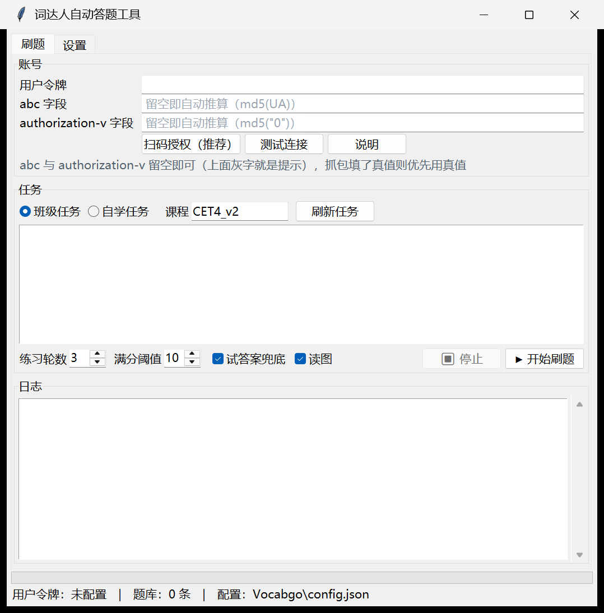
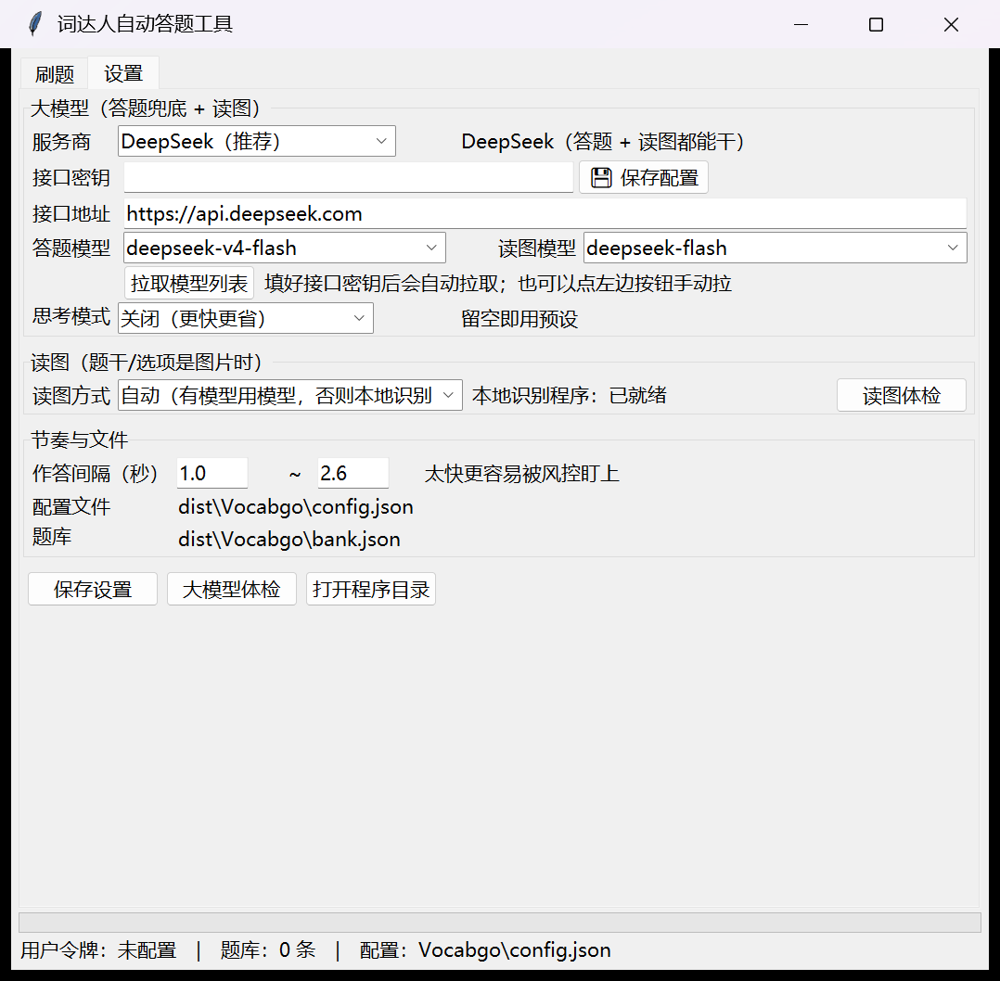
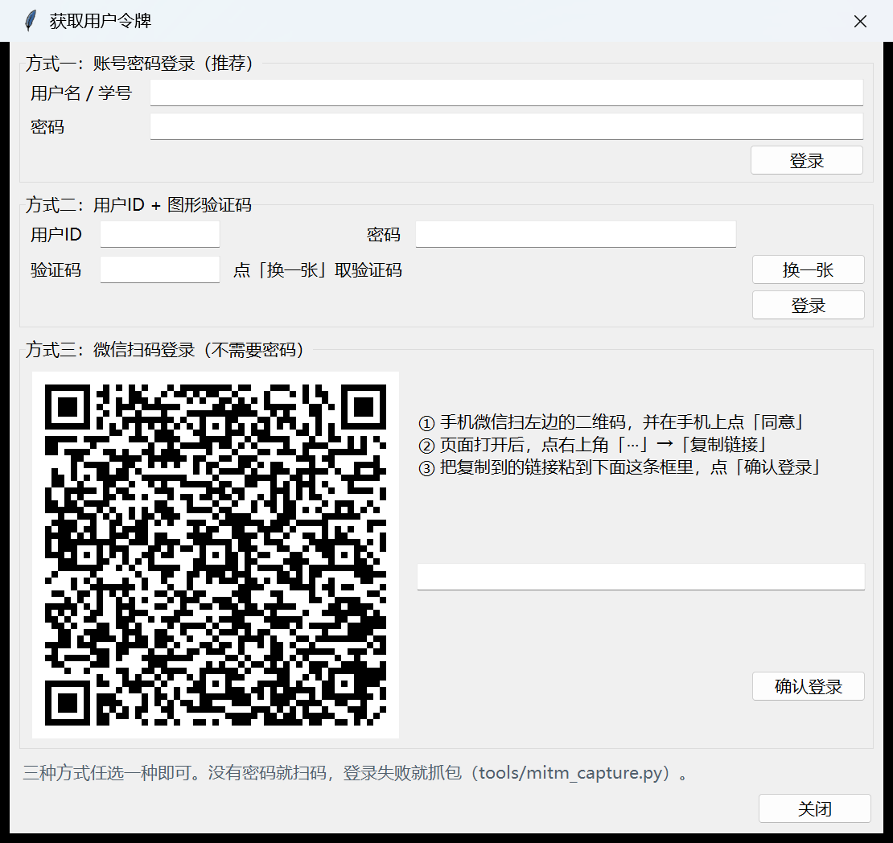

# 词达人自动答题工具（vocabgo）

微信「词达人」（vocabgo / 外教社学生端）的自动答题工具：**班级任务 + 自学任务全题型自动完成**，
带图形界面、DeepSeek 大模型兜底、本地题库、读图（OCR）兜底，可一键打包成免安装的 Windows 软件。

```
自动过班级任务 / 自学任务 · 自动选词 · 自动签到 · 按阈值重练到满分
```

> 仅供学习与技术研究，请在你**本人账号**上使用。接口随时可能调整，失效时见 [兼容性快照](docs/安全与测试报告.md#五兼容性快照2026-10-13-实测)。

---

## 预览

| 刷题页 | 设置页 | 登录获取令牌 |
| --- | --- | --- |
|  |  |  |

---

## 功能

- **全题型覆盖**：单词记忆、词义选择、句中选义、短语排序、搭配多选
- **一条流水线做完**：自动选满词 → 自动答题 → 自动签到 → 按阈值重练直到刷满
- **答题有策略**，先干净后兜底：

  ```
  读图 → 题库 → 规则匹配 → 试答案 → 大模型 → 盲选
  ```

  命中来源会在日志里标出来（`[题库] [规则] [试答案] [大模型]`），一眼看出这一趟干净不干净
- **本地题库**：答过的题写进 `bank.json`，同题下次直接命中，越用越快
- **DeepSeek 一把 key 干两件事**：答题兜底 + 读图（`deepseek-flash` 支持图片输入）
- **内置读图能力**：题干/选项万一以图片下发，自动识别成文字（大模型 / 本地 tesseract / 百度 OCR 三选一）
- **中文界面**，配置改动即存，关窗兜盘；下次打开自动带出上次的任务
- **可打包**：一条命令产出免安装的图形界面版 exe，内置凭据安检

---

## 快速开始

### 方式一：用打包好的软件（推荐）

1. 到 [Releases](../../releases) 下载 `vocabgo-auto-v*-win64.zip`，解压到任意目录
2. 双击 `Vocabgo.exe`（首次可能提示"已保护你的电脑" → 更多信息 → 仍要运行）
3. 「设置」页 → 点「⭐ 一键填入推荐配置」→ 填**大模型接口密钥** → 点「💾 保存配置」
4. 「刷题」页 → 点「登录获取令牌」，三种方式任选：
   - **微信扫码**（不用密码）：扫弹窗里的二维码 → 授权后点「⋯ → 复制链接」→ 粘回弹窗 → 确认登录
   - **账号密码**：填用户名/学号 + 密码 → 登录
   - **用户ID + 图形验证码**：点「换一张」取验证码 → 填 ID/密码/验证码 → 登录
5. 点「刷新任务」→ 选中任务 → 「▶ 开始刷题」

> 详细图文教程：解压包里的 `说明书.html`（截图已内嵌，双击即看）

### 方式二：源码运行

```bash
git clone https://github.com/xuhaoranbb-boop/vocabgo-auto.git
cd vocabgo-auto
pip install -r requirements.txt
python vocabgo_app.py          # 图形界面
python -m vocabgo --help       # 命令行
```

---

## 命令行用法

```bash
python -m vocabgo config --recommend            # 写入推荐配置
python -m vocabgo check                         # 检查令牌
python -m vocabgo tasks --kind class            # 列出班级任务
python -m vocabgo run --kind class --index 0    # 刷第 0 个任务
python -m vocabgo run --kind study --course CET4_v2 --index 0
python -m vocabgo llm --image                   # 大模型体检（列模型 + 真对话 + 真读图）
python -m vocabgo vision --test                 # 读图体检（真跑一张合成图）
```

常用开关：`--loop 3`（多轮追满分）、`--no-probe`（关掉试答案）、`--no-ocr`、`--debug`（打印请求与响应）。

---

## 它是怎么工作的

三个技术要点（细节见 [开源项目调研](docs/开源项目调研.md)）：

1. **请求签名**：`md5(参数按 key 升序拼接 + SALT)`，参与签名的字段含 `timestamp` 与 `version`
2. **响应混淆**：`data` 是混淆过的 base64，按 `jv` 方案（删字符段 / 分段重排）还原；
   代码里同时实现了逆运算 `encode_jv()`，用来构造测试数据
3. **试答案**：同一题连错两次后服务端会回吐正确答案；本工具拿到后**再用正确答案重判一次**，
   所以最终落库的仍是正确作答

另外两个鉴权字段 `abc` / `authorization-v` 也能**直接推算**（分别是 `md5(UA)` 和 `md5("0")`），
不抓包也能跑，详见 [安全与测试报告](docs/安全与测试报告.md#32-鉴权字段的构成公开说明)。

---

## 文档

| 文档 | 内容 |
| --- | --- |
| [说明书.html](docs/说明书.html) | 面向使用者的完整图文教程：上手 / 推荐配置 / 详细步骤 / 界面说明 / 15 条 FAQ |
| [安全与测试报告.md](docs/安全与测试报告.md) | **已知脆弱点清单**、安全与隐私边界、106 个测试的覆盖说明、兼容性快照 |
| [开源项目调研.md](docs/开源项目调研.md) | 同类开源项目的横向调研与协议情报汇总 |

---

## 测试

```bash
python -m unittest discover -s tests -p "test_*.py"
# Ran 106 tests — OK
```

| 测试文件 | 用例数 | 覆盖 |
| --- | ---: | --- |
| `test_crypto.py` | 9 | 签名（含已知向量）、`jv` 混淆全方案往返 |
| `test_client.py` | 9 | 鉴权字段推导、UA 联动、抓包值优先 |
| `test_net.py` | 12 | 默认直连（不受环境代理影响）、异常翻译 |
| `test_qrlogin.py` | 14 | 授权接口多域名兜底、二维码渲染、令牌校验 |
| `test_settings.py` | 39 | 配置三层覆盖、推荐配置一致性、GUI 行为 |
| `test_vision.py` | 14 | 图片判定、字段替换、缓存、后端选择 |
| `test_ocr_live.py` | 4 | **真机 OCR**：真渲染图 → 真 tesseract → 真匹配（缺环境自动跳过） |
| `test_solver_e2e.py` | 5 | 端到端：打本地 mock 服务端，判题与准确率对照 |

`tests/mock_server.py` 是个**会较真的假服务端**：它校验签名、用 `jv` 混淆响应、模拟"连错两次才给答案"，
所以这些测试不是在自说自话。它还能单独启动当练习环境：

```bash
python tests/mock_server.py --port 8877
```

---

## 项目结构

```
vocabgo-auto/
├─ vocabgo_app.py          启动入口（GUI；打包也用这个）
├─ vocabgo_cli.py          命令行入口
├─ build_exe.py            打包程序（PyInstaller）
├─ build_release.py        打发布包（程序 + 说明书 + 推荐配置 → zip，含凭据安检）
├─ vocabgo/
│  ├─ crypto.py            请求签名 + jv 混淆解码/编码
│  ├─ client.py            班级任务 / 自学任务接口（含鉴权字段推导）
│  ├─ net.py               网络层：默认直连、代理策略、人话错误信息
│  ├─ matcher.py           题干解析、规则匹配、题目指纹
│  ├─ bank.py              本地题库（文件锁 + 原子替换）
│  ├─ solver.py            答题主流程（策略链 + 统计 + 可中断）
│  ├─ llm.py               DeepSeek 等 OpenAI 兼容模型：答题兜底 + 读图 + 体检
│  ├─ vision.py            读图：图片判定 + OCR + 验证码清洗
│  ├─ qrlogin.py           登录取令牌（账号密码 / 用户ID+验证码）
│  ├─ settings.py          配置中心（默认值 ← config.json ← 环境变量）
│  ├─ paths.py             路径解析（打包后写到 exe 同目录）
│  ├─ gui.py               tkinter 图形界面（中文界面，DPI 自适应）
│  └─ cli.py               命令行子命令
├─ tools/                  抓包插件 / 图标 / 说明书生成为独立脚本
├─ tests/                  mock 服务端 + 106 个用例
└─ docs/                   说明书 / 安全与测试报告 / 开源项目调研
```

---

## 打包

```bash
python build_exe.py                  # dist/Vocabgo（图形界面）+ dist/VocabgoCLI（命令行）
python build_release.py --rebuild    # 组装发布包并压 zip（自带凭据安检）
python build_release.py --onefile    # 单文件版，体积更小
```

打包脚本在生成 zip 前会**逐字节扫描**整个包，发现密钥/令牌/个人配置就中止 —— 避免把自己的凭据发出去。

---

## 开发与自动化

### 提交即推送

仓库带了 `post-commit` 钩子：**每次 commit 后自动推送到 GitHub**（推送失败不影响提交，只提示手动补推）。

首次克隆后启用一次：

```bash
git config core.hooksPath .githooks
```

想临时跳过：`git commit --no-verify`。

### CI 与自动发版

`.github/workflows/` 下准备了两个工作流：

| 工作流 | 触发 | 干什么 |
| --- | --- | --- |
| `ci.yml` | 每次 push / PR | 在 Windows + Linux、Python 3.12/3.13 上跑全部测试 |
| `release.yml` | push `v*` 标签 | 自动打包 exe 并创建 GitHub Release |

推送 workflow 文件需要令牌带 `workflow` 权限，遇到下面这个错就补一次：

```bash
gh auth refresh -s workflow
```

```
! [remote rejected] main -> main
  (refusing to allow an OAuth App to create or update workflow
   `.github/workflows/ci.yml` without `workflow` scope)
```

### 平台变更踩坑表

下面几条都是**平台侧改了东西**造成的，出现新问题先照这里排查：

| 现象 | 真因 | 现在的做法 |
| --- | --- | --- |
| 扫码后「微信认证失败」 | 旧扫码授权链路被平台改掉 | 改走 `?authorize=0` 拿 code，再自己解密 |
| 登录响应「加密失败！」 | 服务端要用客户端公钥加密响应 | 本地生成 ECDH P-256 密钥对，HKDF + AES-GCM 解密 |
| 创建自学任务「请重新登录」 | `StudyTask/StartTask` 被服务端特殊保护 | 改用 `StudyTask/Info` 传 `task_id=-1` 让服务端建 |
| 刷到一半突然 `11003 需安全验证` | 令牌有效期实测约 **6 小时** | 记下获取时间，5.5 小时起主动提醒重新登录 |
| 班级任务「加载任务信息失败」 | 未开始的任务 `task_id=-1` | 列表里标 `⚠️未开始`，自动跳过并说明怎么办 |

---

## 常见问题

**令牌失效了？** 重新点「登录获取令牌」。刷题期间不要在手机或其它设备登录词达人，否则令牌会被刷新。

**报错 `ProxyError` / `JSONDecodeError`？** 电脑上的代理在作怪。本工具默认直连并忽略系统代理；
仍失败请到「设置」页确认「代理」留空且没勾「跟随系统代理」。

**登录报「用户名错误 / 密码错误」？** 用户名通常是手机号或学号（不是昵称）。忘了密码就直接用**微信扫码**方式，或用抓包（[说明书](docs/说明书.html)方式 D）。

**扫码后提示「微信服务异常」？** 说明链接里的 code 过期或用过了（只能用一次、约 5 分钟有效）。重新扫一次，拿到新链接后尽快粘贴。

**分数没满？** 把「练习轮数」调到 3~5，程序会自动重练未满分的词。

更多见 [说明书 FAQ](docs/说明书.html)。

---

## 免责声明

本项目仅用于学习与技术研究，请在你本人账号上使用并遵守平台用户协议。
自动化操作处于平台规则的灰色地带，可能被限制，**风险自负**，作者不对使用后果负责。

## 致谢

协议细节来自对以下公开开源项目的调研与交叉验证，在此致谢：

- [github123666/cidaren](https://github.com/github123666/cidaren)（原项目）
- [ularch/Easy_Cidaren](https://github.com/ularch/Easy_Cidaren)
- [LangQi99/cidaren](https://github.com/LangQi99/cidaren)
- [Rain-shadow/cdr](https://github.com/Rain-shadow/cdr)
- [haojiezhe12345/vocabgo-auto](https://github.com/haojiezhe12345/vocabgo-auto)

## License

[MIT](LICENSE)
